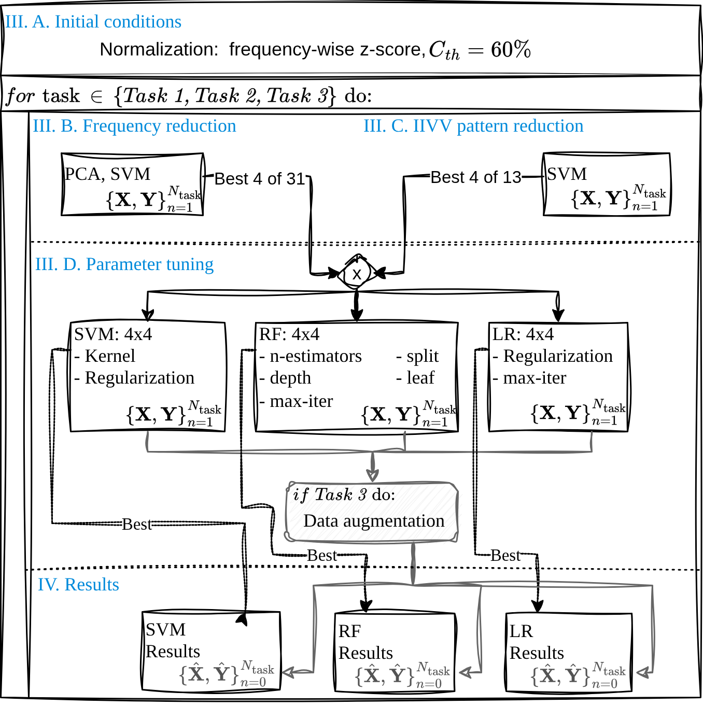

# IIVV Evaluation

Repository for the paper: _In Vivo Oral Lesion Classification Using Optimized Electrical Impedance Spectroscopy_

**Optimization schedule line out**

<p align="center", width="300px">
  
</p>
<p align="center" style="font-size: smaller;">
  <em>Fig. 1: Optimization and tuning schedule.</em>
</p>


- [Frequency reduction](Frequency-reduction.ipynb)
- [IIVV pattern reduction](IIVV-pattern-reduction.ipynb)
- [Model and parameter tuning](Model-and-parameter-tuning.ipynb)
- [Baseline performance](Results-Baseline.ipynb) vs. [final performance](Results.ipynb)
- [Statistics and figures](Statistics-and-figures.ipynb)

___
For referencing this work, please cite:

```
TBD:Citation key
```