# A Machine-Learning Approach to Optimize Electrical Impedance Spectroscopy-based Classification of In Vivo Oral Lesions

Repository for the IEEE-JBMI paper: _A Machine-Learning Approach to Optimize Electrical Impedance Spectroscopy-based Classification of In Vivo Oral Lesions_

## Reviewer revision workflow

Run `./run_all.sh --output results/revision-clinical-final` for the nested patient-group analysis, including source verification, the combined referral task, requested metrics, sensitivity analyses, and regenerated figures. Use a fresh output directory for another run.

See [code-revisions.md](code-revisions.md) for prerequisites, input schemas, exact search settings, reviewer-to-code mapping, artifact descriptions, and scientific limitations. Check completion with `python 5_check_results.py --results-dir results/revision-clinical-final`.

The figures below are the **historical exploratory results**. Revised results are written to the selected new output directory. Manuscript changes are in `manuscript/Paper/Revision-1.tex`; build with `make revision response`.

# Historical results overview

<!-- ========= Baseline ========= -->

## Baseline

### Healthy vs Cancer

**LR**

<p align="center">
  
  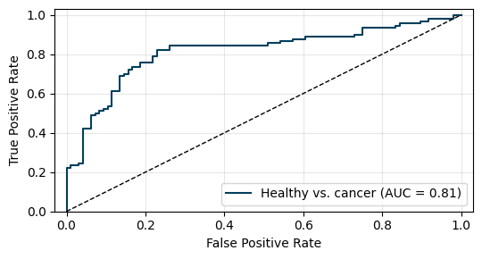
</p>

**RF**

<p align="center">
  
  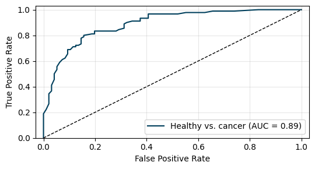
</p>

**SVM**

<p align="center">
  
  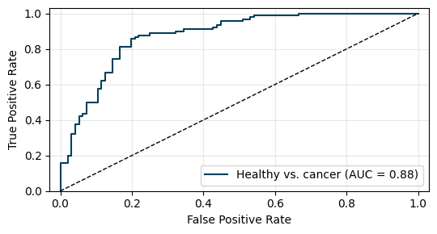
</p>

### Cancer vs. high risk vs. low risk

**LR**

<p align="center">
  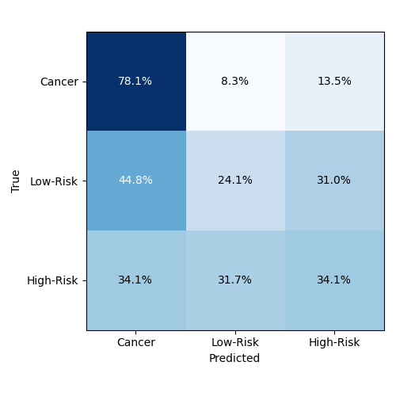
  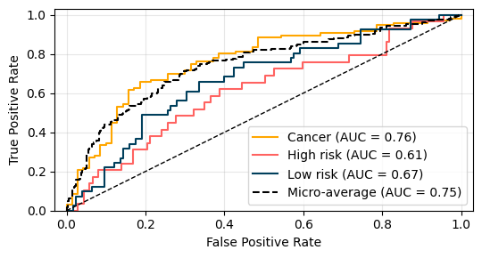
</p>

**RF**

<p align="center">
  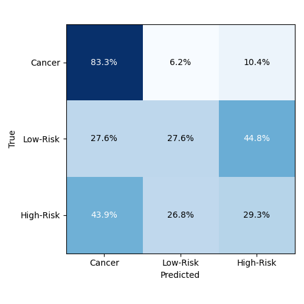
  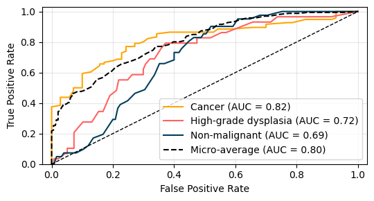
</p>

**SVM**

<p align="center">
  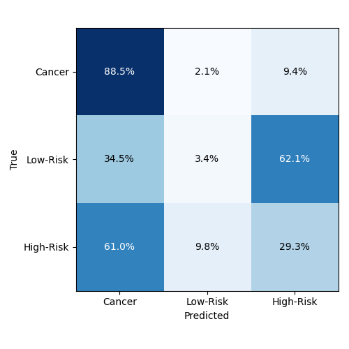
  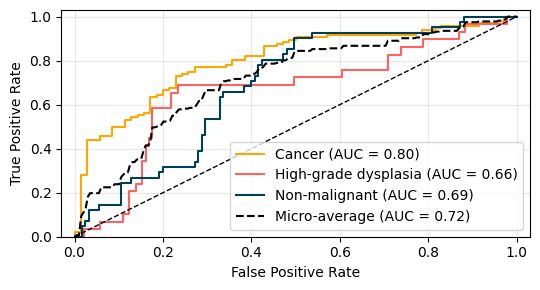
</p>

### Multiclass

**LR**

<p align="center">
  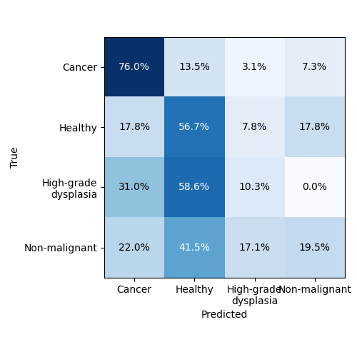
  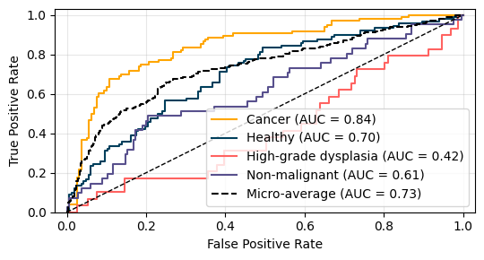
</p>

**RF**

<p align="center">
  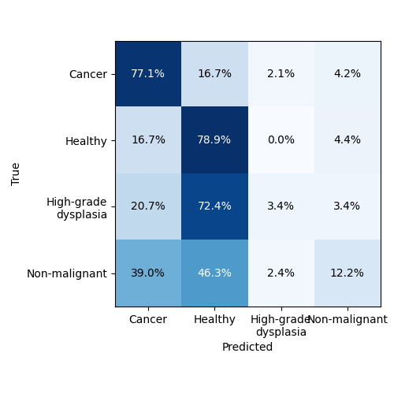
  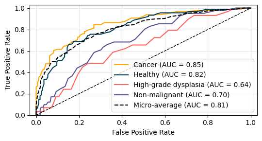
</p>

**SVM**

<p align="center">
  
  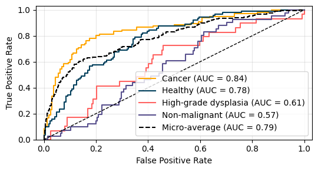
</p>

<!-- ========= AUC ========= -->

## Tuned models with AUC metric

### Healthy vs. cancer

**LR**

<p align="center">
    
  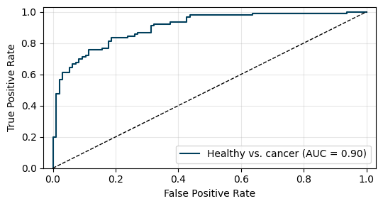
</p>

**RF**

<p align="center">
  
  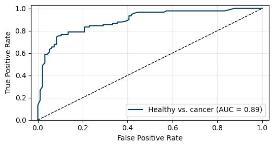
</p>

**SVM**

<p align="center">
  
  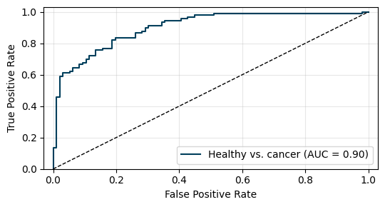
</p>

### Cancer vs. high risk vs. low risk

**LR**

<p align="center">
  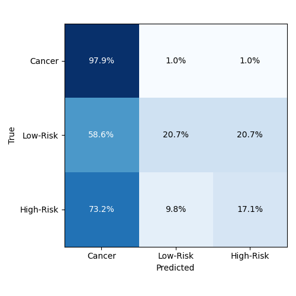  
  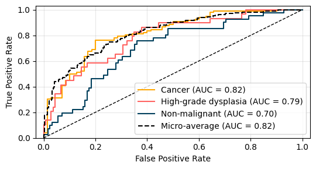
</p>

**RF**

<p align="center">
  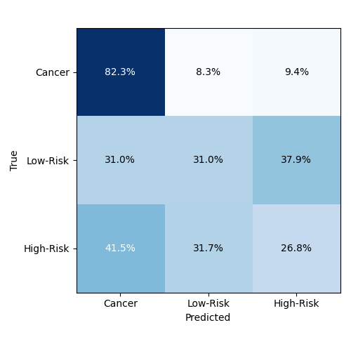
  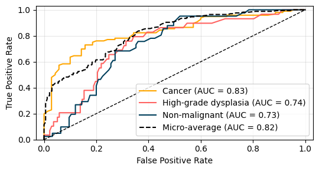
</p>

**SVM**

<p align="center">
  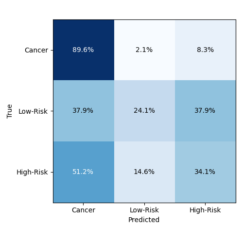
  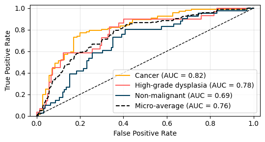
</p>

### Multiclass

**LR**

<p align="center">
  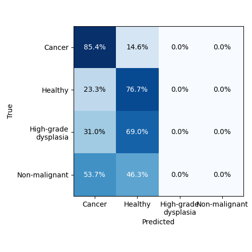  
  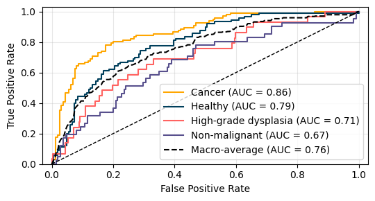
</p>

**RF**

<p align="center">
  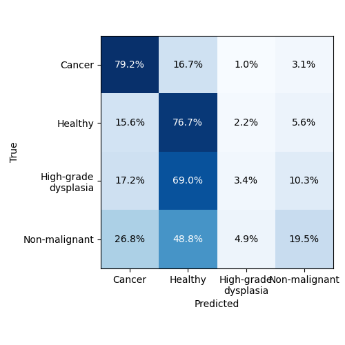
  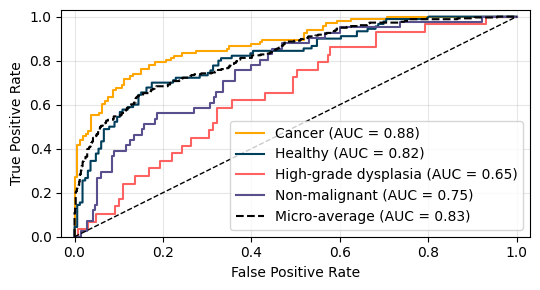
</p>

**SVM**

<p align="center">
  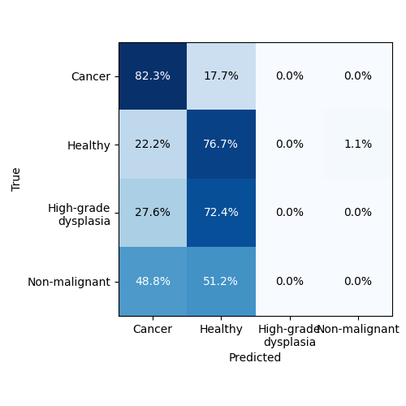
  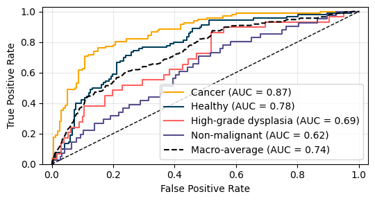
</p>

<!-- ========= F1 ========= -->

## Tuned models with F1 metric

### Healthy vs. cancer

**LR**

<p align="center">
  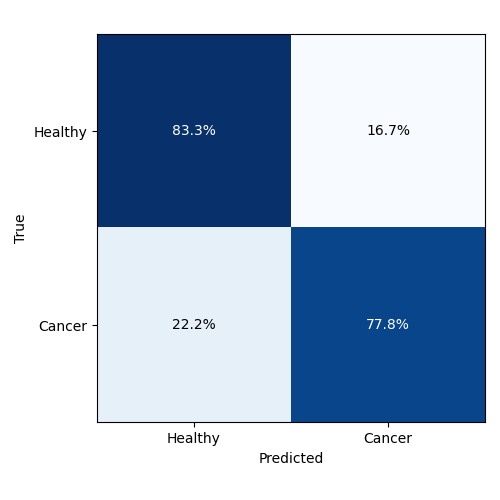  
  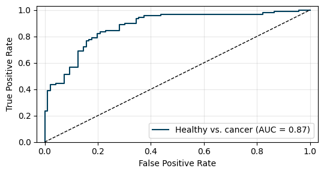
</p>

**RF**

<p align="center">
  
  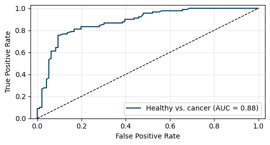
</p>

**SVM**

<p align="center">
  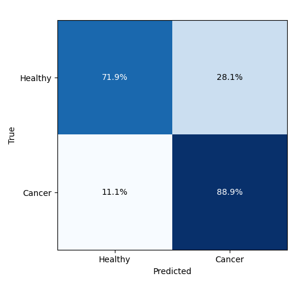
  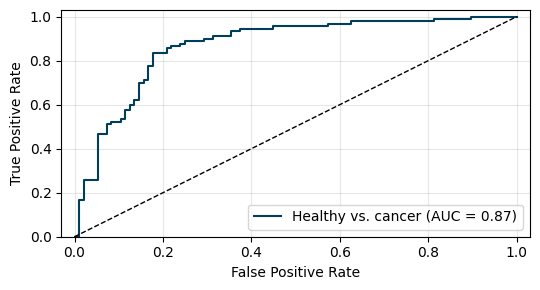
</p>

### Cancer vs. high risk vs. low risk

**LR**

<p align="center">
  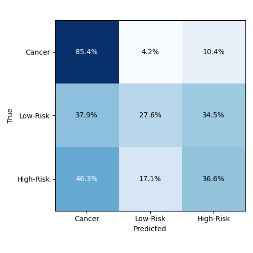  
  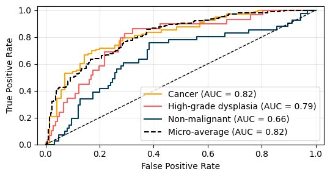
</p>

**RF**

<p align="center">
  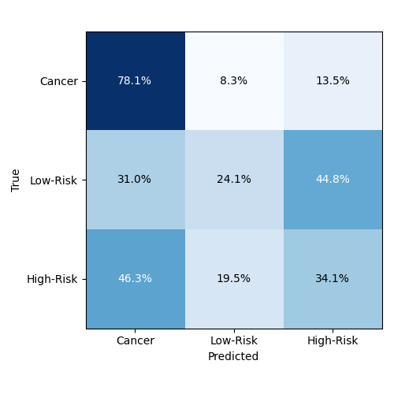
  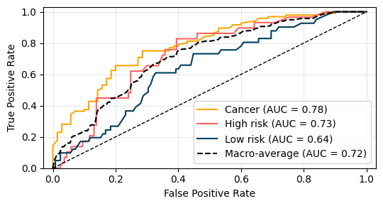
</p>

**SVM**

<p align="center">
  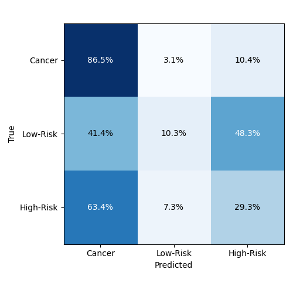
  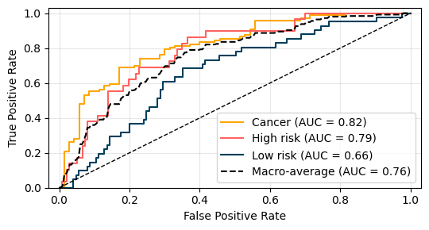
</p>

### Multiclass

**LR**

<p align="center">
  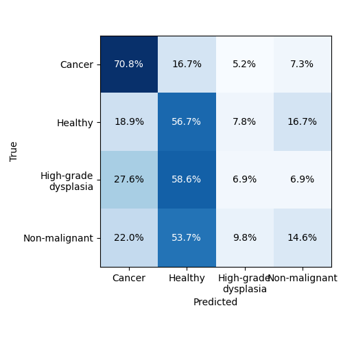  
  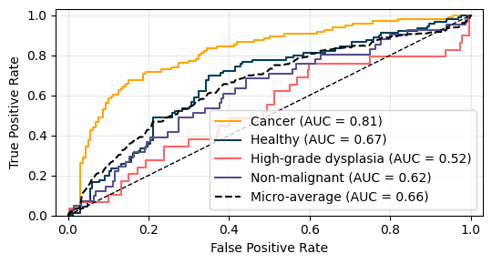
</p>

**RF**

<p align="center">
  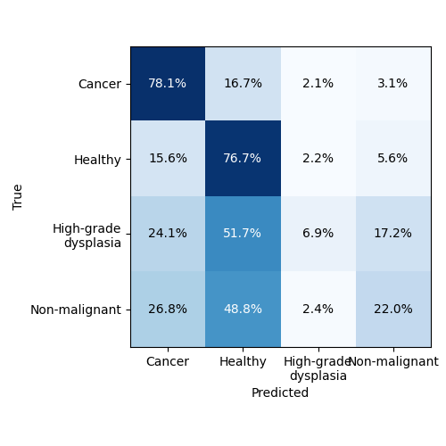
  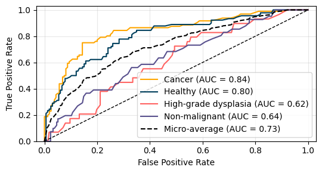
</p>
  
  **SVM**

<p align="center">
  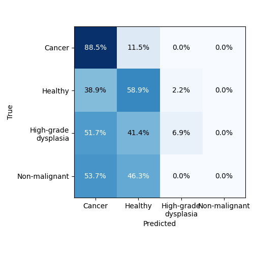
  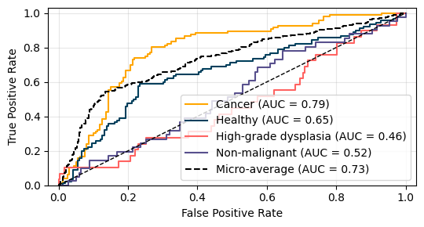
</p>

<!-- ========= ACC ========= -->

## Tuned models with ACC metric

### Healthy vs. cancer

**LR**

<p align="center">
    
  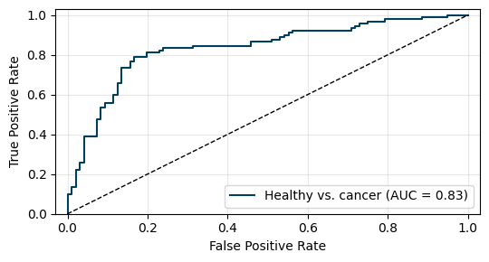
</p>

**RF**

<p align="center">
  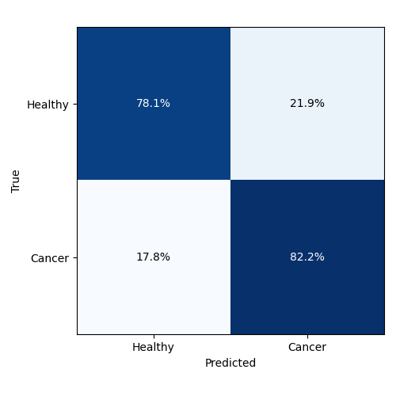
  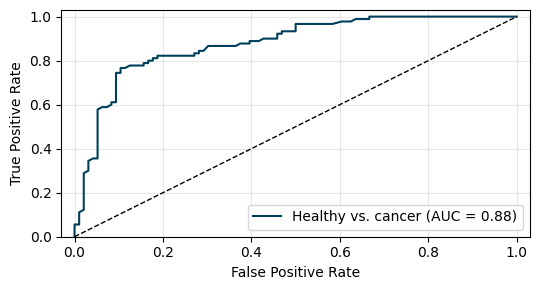
</p>

**SVM**

<p align="center">
  
  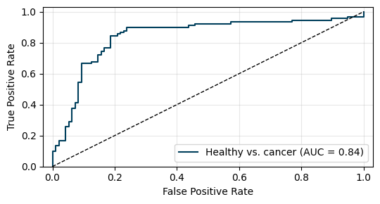
</p>

### Cancer vs. high risk vs. low risk

**LR**

<p align="center">
    
  
</p>

**RF**

<p align="center">
  
  
</p>

**SVM**

<p align="center">
  
  
</p>

### Multiclass

**LR**

<p align="center">
    
  
</p>

**RF**

<p align="center">
  
  
</p>
 
  **SVM**

<p align="center">
  
  
</p>

---

# Results creation

## IIVV selection

Configure the following shell script for the metric and start it to run it for all tasks. F1-score is preferrec in medical applications.

    ./1_1run_tmux_iivv.sh

To see the tuning results, run

    ./print_eval_results.py --only mask

## Frequency and z-threshold rankings

Configure the following shell script for the metric and start it to run it for all tasks. F1-score is preferrec in medical applications.

    ./1_2run_tmux_freq.sh

To see the tuning results, run

    ./print_eval_results.py --only freq

## Model and parameter tuning

Configure the following shell script for the metric and start it to run it for all tasks. F1-score is preferrec in medical applications.

    ./2_run_tmux_model_tuning.sh

To see the tuning results, run

    ./print_tuning_results.py

## Show the best performing models

    ./print_tuning_results.py --top 4

or of an specific file

    ./print_tuning_results.py --pattern "GPU_tuning_*AGG.csv" --top 4

## Create plots and final results

    ./3_final_results.py --task MC --metric f1 --model svm

## Create baseline results and plots

    ./4_results_baseline.py --task healthy_vs_cancer
    ./4_results_baseline.py --task cancer_vs_lr_hr
    ./4_results_baseline.py --task MC

## Check the available/created results

    ./5_check_results.py

---

## Build the manuscript locally

The LaTeX sources are kept in the local-only `manuscript/` directory and are
ignored by Git. With a TeX Live installation that includes `latexmk`, `biber`,
and the required packages, build all documents from the repository root with:

    make manuscript

Individual documents can be built with `make paper`, `make revision`, or
`make response`. Generated PDFs and auxiliary build files remain inside
`manuscript/` and are ignored by Git. To remove those generated files, run:

    make clean-manuscript

**Documentation of the script options**

_script.py_ and -h, --help shows help message and exit

---

For referencing this work, please cite:

```
TBD:Citation paper
```

and the repository:

```
@software{IIVV_Evaluation_2025,
    author = {Thönes, Jacob P., Sophie A. Lloyd},
    license = {MIT},
    month = sep,
    title = {{IIVV Evaluation}},
    url = {https://github.com/EITLabworks/IIVV-Evaluation},
    version = {0.1.0},
    year = {2025}
}
```
