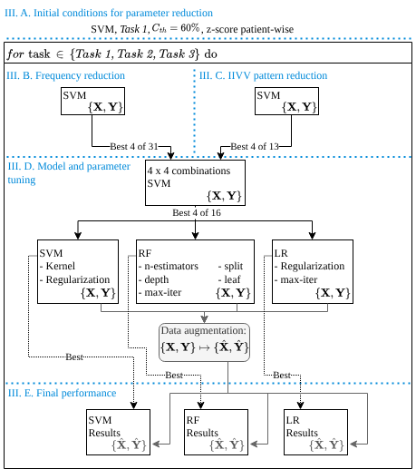

# IIVV Evaluation

Repository for the paper: _Title paper_

<p align="center">
  
</p>
<p align="center" style="font-size: smaller;">
  <em>Fig. 1: Optimization and tuning schedule.</em>
</p>

**Optimization schedule line out**

- [Frequency reduction](Frequency-reduction.ipynb)
- [IIVV pattern reduction](IIVV-pattern-reduction.ipynb)
- [III-D Model and parameter tuning](Model-and-parameter-tuning.ipynb)

___
For referencing this work, please cite:

```
TBD:Citation key
```