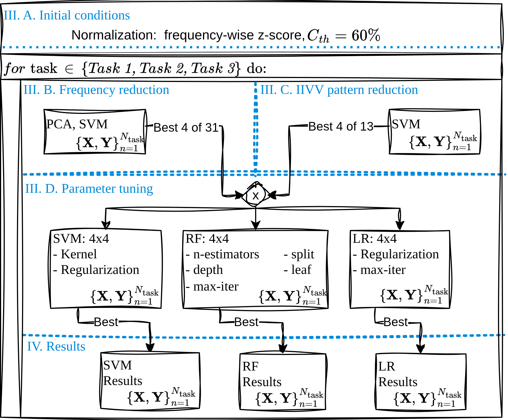

# IIVV Evaluation

Repository for the paper: _In Vivo Oral Lesion Classification Using Optimized Electrical Impedance Spectroscopy_

**Optimization schedule**

<p align="center", width="300px">
  
</p>
<p align="center" style="font-size: smaller;">
  <em>Fig. 1: Optimization and tuning schedule.</em>
</p>

## IIVV selection

Configure the following shell script for the metric and start it to run it for all tasks. F1-score is preferrec in medical applications.

    ./1_1run_tmux_iivv.sh

To see the tuning results, run

    ./print_eval_results.py --only mask

## Frequency and z-threshold rankings

Configure the following shell script for the metric and start it to run it for all tasks. F1-score is preferrec in medical applications.

    ./1_2run_tmux_freq.sh

To see the tuning results, run

    ./print_eval_results.py --only freq

## Model and parameter tuning

Configure the following shell script for the metric and start it to run it for all tasks. F1-score is preferrec in medical applications.

    ./2_run_tmux_model_tuning.sh

To see the tuning results, run

    ./print_tuning_results.py

## Show the best performing models

    ./print_tuning_results.py --top 4

or of an specific file

    ./print_tuning_results.py --pattern "GPU_tuning_*AGG.csv" --top 4

## Create plots and final results

    ./3_final_results.py --task MC --metric f1 --model svm


___

**Documentation of the script options**


options `1_1iivv_gpu_eval.py`:
  --task {healthy_vs_cancer,cancer_vs_lr_hr,MC}
                        Classification task to run
  --metric {auc,acc,f1}
                        Metric used for scoring and ranking masks
  --n_trials N_TRIALS
  --n_folds N_FOLDS
  --max_iter MAX_ITER
  --results_dir RESULTS_DIR
  --logs_dir LOGS_DIR

options `1_2freq_gpu_eval.py`:
  -h, --help            show this help message and exit
  --task {healthy_vs_cancer,cancer_vs_lr_hr,MC}
  --metric {auc,acc,f1}
  --n_trials N_TRIALS
  --n_folds N_FOLDS
  --max_iter MAX_ITER
  --max_freqs MAX_FREQS
  --results_dir RESULTS_DIR
  --logs_dir LOGS_DIR

options `print_eval_results.py`:
  -h, --help            show this help message and exit
  --results_dir RESULTS_DIR
  --top TOP             Show top-k per ranking
  --only {all,mask,freq}
                        Print only mask or freq rankings
  --metrics METRICS     Comma-separated metrics to print (default: auc,acc,f1)
  --tasks TASKS         Comma-separated tasks to print

options `2_model_gpu_tuning.py`:
  -h, --help            show this help message and exit
  --model {svm,rf,lr,all}
  --task TASK           healthy_vs_cancer, cancer_vs_lr_hr, MC
  --positive-class POSITIVE_CLASS
                        If set: binarize labels as (label == positive_class).
  --metric {auc,f1,acc}
                        Optimization metric.
  --n-splits N_SPLITS
  --n-group-seeds N_GROUP_SEEDS
  --n-trials N_TRIALS
  --results-path RESULTS_PATH
  --data-path DATA_PATH
  --norm NORM
  --no-gpu

options `print_tuning_results.py`:
  -h, --help         show this help message and exit
  --path PATH        Folder with tuning CSV files
  --pattern PATTERN  Glob pattern (default: *.csv)
  --top TOP          How many top rows to print

options `3_final_results.py`:
  -h, --help            show this help message and exit
  --task {healthy_vs_cancer,cancer_vs_lr_hr,MC}
  --metric METRIC
  --model {all,rf,lr,svm}
  --results-path RESULTS_PATH
  --outdir OUTDIR
___
For referencing this work, please cite:

```
TBD:Citation paper
```

and the repository:

```
@software{Thones_IIVV_Evaluation_2025,
    author = {Thönes, Jacob P., Sophie A. Lloyd},
    license = {MIT},
    month = sep,
    title = {{IIVV Evaluation}},
    url = {https://github.com/EITLabworks/IIVV-Evaluation},
    version = {0.1.0},
    year = {2025}
}
```